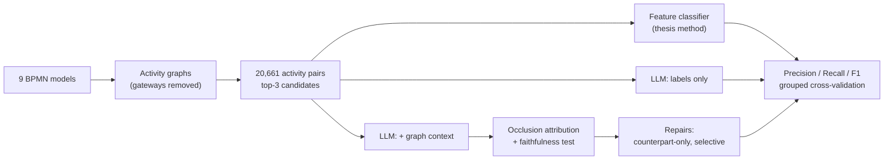

<a id="readme-top"></a>

<h2 align="center">When Graph Context Hurts</h2>
<h4 align="center">Explaining and repairing LLM reasoning for business process matching</h4>

<p align="center">
  <a href="https://colab.research.google.com/github/sidraanwar23/graph-rag-process-matching/blob/main/01_data_and_baselines.ipynb"></a>
  
  
  
  
</p>

<p align="center">
  Graph-RAG gives an LLM more evidence. This project asks a simple question: <b>does that evidence actually help it reason?</b><br/>
  On business process matching, the answer was no, and the reason was worth finding.
</p>

---

## Key findings

| | Finding |
|---|---|
| **1** | Giving an LLM the graph neighbourhood of each activity raised **precision from 0.53 to 0.79** but cut **recall from 0.66 to 0.21**. The model became precise but far too cautious. |
| **2** | A **single neighbouring step can flip a decision**. The model rejected two *identical* labels ("Send letter of rejection") because of one neighbour, "Evaluate". |
| **3** | The explanations are **faithful**: removing the top-ranked context element changes the model's answer **3.5× more** than removing a random one. |
| **4** | Keeping only neighbours that have a counterpart in the other process **recovered 31 lost matches** (recall 0.31 → 0.48, precision 0.71), with no gold labels used. |
| **5** | The LLM is **almost always fully confident**, even when wrong: only 22 of 4,244 pairs fell between P(Yes) 0.3 and 0.7. |

<details>
  <summary><b>Table of contents</b></summary>
  <ol>
    <li><a href="#the-problem">The problem</a></li>
    <li><a href="#pipeline">Pipeline</a></li>
    <li><a href="#data">Data</a></li>
    <li><a href="#experiment-1-and-2-does-graph-context-help">Experiments 1 and 2: does graph context help?</a></li>
    <li><a href="#experiment-3-why-graph-context-hurts">Experiment 3: why graph context hurts</a></li>
    <li><a href="#license">License</a></li>
  </ol>
</details>

## The problem

When two organizations merge, someone has to work out which steps in their business processes are actually the same. That sounds easy until you look at the labels. "Notify students to collect cards" and "Inform students about card collection" describe the same thing, while two labels that look alike can describe different work.

My MS thesis tackled this with text alone: I expanded short activity labels into fuller descriptions with T5 and then classified pairs. It worked, but it ignored something obvious. A process model is a graph, and every activity sits between other activities.

[*The Reasoning Bottleneck in Graph-RAG*](https://arxiv.org/abs/2603.14045) (Zarrinkia, Srinivasan and Thomo, 2026) shows that LLMs often have the right retrieved context and still reason over it badly. Process matching is a small, clean setting with exact gold labels, which makes it a good place to see that failure up close, explain it, and try to fix it.

<p align="right">(<a href="#readme-top">back to top</a>)</p>

## Pipeline



## Data

The University Admission set from the [Process Model Matching Contest 2015](https://ai.wu.ac.at/emisa2015/contest.php): 9 BPMN models of how German universities handle Master's applications.

| | |
|---|---|
| Process models | 9 |
| Model pairs with expert alignments | 36 |
| Activity pairs | 20,661 |
| True matches | 178 (0.86%) |
| Candidate pairs sent to the LLM | 4,244 (top 3 per activity, both directions) |
| True matches among candidates | 82% |

Each model is turned into a directed graph. Activities are nodes, the lane or pool gives the actor, and an edge links an activity to the next one, skipping gateways and events.

<p align="right">(<a href="#readme-top">back to top</a>)</p>

## Experiment 1 and 2: does graph context help?

| Method | What the model sees | Precision | Recall | F1 |
|---|---|---|---|---|
| Feature-based classifier | FLAN-T5 descriptions, string and embedding similarity, Gradient Boosting | 0.791 | 0.702 | **0.744** |
| Hybrid | the classifier plus the three LLM scores | 0.703 | **0.730** | 0.716 |
| LLM, labels only | the two labels | 0.529 | 0.663 | 0.589 |
| LLM + graph context + checklist | labels, neighbours, actor, and a "check step by step" prompt | 0.764 | 0.309 | 0.440 |
| LLM + graph context | labels, up to 3 steps before and after, and the actor | **0.787** | 0.208 | 0.329 |

*LLM scores are the next-token probability of "Yes" from Qwen2.5-7B-Instruct (4-bit), thresholded at 0.5. Everything trained or tuned uses 6-fold cross-validation grouped by model pair, so a test pair is never seen in training.*

Graph context made the LLM much more precise, but it also made it reject most real matches. Tuning the threshold did not undo this (F1 0.37 at best), so context changes the *ranking* of pairs, not just the scale of the scores.

<p align="right">(<a href="#readme-top">back to top</a>)</p>

## Experiment 3: why graph context hurts

For 400 candidate pairs I removed one context element at a time (a step before, a step after, or the actor) and measured how much the model's P(Yes) changed. This is occlusion attribution: simple, model-agnostic, and easy to check.

### One neighbour can flip a decision

Graph context made the model reject 64 true matches. The clearest case:

```text
University A: "Send letter of rejection"      University B: "Send letter of rejection"

LLM, labels only                       P(Yes) = 1.00   correct
LLM + full graph context               P(Yes) = 0.00   wrong    <- neighbour "Evaluate" pushes it by -0.99
LLM + counterpart-only context         P(Yes) = 1.00   correct
```

### The explanations are faithful

If attribution finds the elements the model really relies on, removing them should matter more than removing random ones.

| Elements removed | Mean change in P(Yes), top-ranked | Mean change, random | Decision flips, top-ranked | Decision flips, random |
|---|---|---|---|---|
| 1 | **0.164** | 0.047 | **17.5%** | 4.3% |
| 2 | **0.219** | 0.074 | **23.3%** | 5.8% |

### Step order is not the whole story

My first guess was that universities simply order their steps differently, so neighbours without a counterpart in the other process would do the damage. The data says otherwise: on the lost matches, neighbours *with* a counterpart pushed towards "no match" about as hard as those without (mean −0.117 vs −0.110). Context in general can mislead the model.

<p align="center">
  
</p>

### Repairs, with no gold labels

| Method | Precision | Recall | F1 |
|---|---|---|---|
| LLM, labels only | 0.529 | 0.663 | 0.589 |
| LLM + full context + checklist | 0.764 | 0.309 | 0.440 |
| **LLM + counterpart-only neighbours** | **0.705** | **0.483** | **0.573** |
| Selective context (used only when 0.3 ≤ P(Yes) ≤ 0.7) | 0.551 | 0.640 | 0.592 |
| Selective + counterpart-only neighbours | 0.553 | 0.646 | 0.596 |

Keeping only neighbours that have a counterpart on the other side recovered 31 true matches while keeping most of the precision gain. Selective context barely changed anything, and the reason is itself a finding: the model is almost never uncertain, so the gate almost never opens.

The feature-based classifier is still the strongest single method. This is one small benchmark, so I treat these results as early evidence, not a conclusion.

<p align="right">(<a href="#readme-top">back to top</a>)</p>

## License

Distributed under the MIT License. See `LICENSE` for details.

<p align="right">(<a href="#readme-top">back to top</a>)</p>
