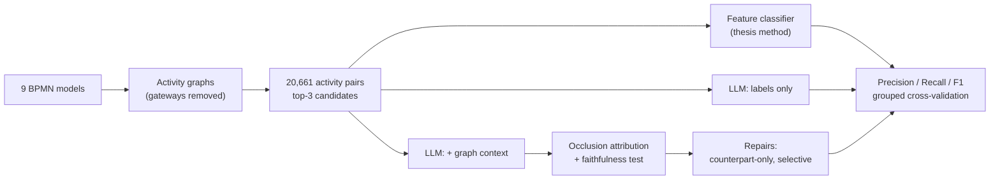
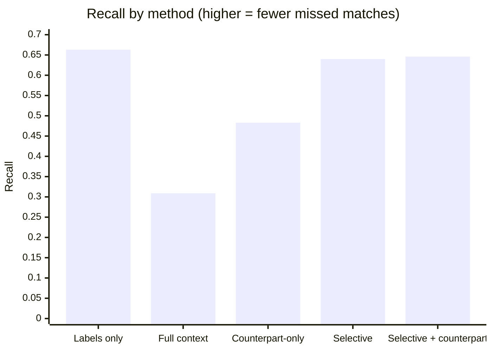

<a id="readme-top"></a>

<h2 align="center">When Graph Context Hurts</h2>
<h4 align="center">Explaining and repairing LLM reasoning for business process matching</h4>

<p align="center">
  <a href="https://colab.research.google.com/github/sidraanwar23/graph-rag-process-matching/blob/main/01_data_and_baselines.ipynb"></a>
  
  
  
  
</p>

<p align="center">
  Graph-RAG assumes that more context leads to better answers.<br/>
  This project tests that assumption on business process matching, finds where it breaks, and explains why.
</p>

---

## Key findings

| | |
|---|---|
| **Context made the model cautious** | Adding each activity's graph neighbourhood raised precision from 0.53 to 0.79, but recall fell from 0.66 to 0.21. |
| **One step can change the answer** | The model rejected two identical labels, "Send letter of rejection", because of a single neighbouring step. |
| **The explanations hold up** | Removing the context element ranked most important changed the model's answer 3.5 times more than removing a random one. |
| **Less context worked better** | Keeping only neighbours with a counterpart in the other process recovered 31 lost matches (recall 0.31 → 0.48, precision 0.71). |
| **The model is rarely unsure** | Only 22 of 4,244 pairs scored between 0.3 and 0.7, even though many of its answers were wrong. |

<details>
  <summary><b>Contents</b></summary>
  <ol>
    <li><a href="#the-problem">The problem</a></li>
    <li><a href="#pipeline">Pipeline</a></li>
    <li><a href="#data">Data</a></li>
    <li><a href="#experiment-1-and-2-does-graph-context-help">Experiments 1 and 2: does graph context help?</a></li>
    <li><a href="#experiment-3-why-graph-context-hurts">Experiment 3: why graph context hurts</a></li>
    <li><a href="#license">License</a></li>
  </ol>
</details>

## The problem

When two organizations merge, they have to decide which steps in their business processes are the same. The process models make this harder than it sounds, because each activity is described by a short label written in its own style. "Notify students to collect cards" and "Inform students about card collection" mean the same thing, while two labels that look almost identical can describe different work.

My MS thesis approached this with text alone: short labels were expanded into fuller descriptions and then classified as matching or not. What that approach ignored is that a process model is a graph. Every activity has steps before it, steps after it, and someone responsible for it.

Recent work on Graph-RAG ([Zarrinkia, Srinivasan and Thomo, 2026](https://arxiv.org/abs/2603.14045)) shows that language models often receive the right context and still reason over it poorly. Process matching is a useful place to study this. The task is small, the graphs are clean, and every answer can be checked against expert labels.

<p align="right">(<a href="#readme-top">back to top</a>)</p>

## Pipeline



## Data

The experiments use the University Admission collection from the [Process Model Matching Contest 2015](https://ai.wu.ac.at/emisa2015/contest.php), which models how nine German universities handle Master's applications.

| | |
|---|---|
| Process models | 9 |
| Model pairs with expert alignments | 36 |
| Activity pairs | 20,661 |
| True matches | 178 (0.86%) |
| Candidate pairs scored by the LLM | 4,244 (top 3 per activity, both directions) |
| True matches among the candidates | 82% |

Each BPMN model becomes a directed graph. Activities are nodes, the lane or pool supplies the actor, and an edge connects an activity to the one that follows it, with gateways and events removed.

<p align="right">(<a href="#readme-top">back to top</a>)</p>

## Experiment 1 and 2: does graph context help?

| Method | Input | Precision | Recall | F1 |
|---|---|---|---|---|
| Feature-based classifier | FLAN-T5 descriptions, string and embedding similarity, gradient boosting | 0.791 | 0.702 | **0.744** |
| Hybrid | the classifier plus the three LLM scores | 0.703 | **0.730** | 0.716 |
| LLM, labels only | the two labels | 0.529 | 0.663 | 0.589 |
| LLM + graph context + checklist | labels, neighbours, actor and a step-by-step checklist | 0.764 | 0.309 | 0.440 |
| LLM + graph context | labels, up to three steps before and after, and the actor | **0.787** | 0.208 | 0.329 |

*LLM scores are the probability of "Yes" as the next token from Qwen2.5-7B-Instruct (4-bit), with a threshold of 0.5. Every trained or tuned component uses 6-fold cross-validation grouped by model pair, so no test pair is seen during training.*

Graph context made the model much more precise and much less willing to call anything a match. Tuning the threshold did not fix this: the best tuned F1 was 0.37. The context changed which pairs the model ranked highly, not just how confident it was.

<p align="right">(<a href="#readme-top">back to top</a>)</p>

## Experiment 3: why graph context hurts

To find out which parts of the context drove these decisions, I took 400 candidate pairs, removed one context element at a time (a preceding step, a following step or the actor), and recorded how the model's probability of "Yes" changed. This is occlusion attribution: simple, model-agnostic and easy to verify.

### One step can change the answer

Graph context caused the model to reject 64 true matches. The clearest example involves two activities with exactly the same name:

```text
University A: "Send letter of rejection"      University B: "Send letter of rejection"

LLM, labels only                       P(Yes) = 1.00   correct
LLM + full graph context               P(Yes) = 0.00   wrong    <- neighbour "Evaluate" pushes it by -0.99
LLM + counterpart-only context         P(Yes) = 1.00   correct
```

### The explanations hold up

An attribution is only useful if it reflects what the model actually relies on. If it does, removing the top-ranked elements should matter far more than removing random ones, and it does:

| Elements removed | Mean change in P(Yes), top-ranked | Mean change, random | Decisions flipped, top-ranked | Decisions flipped, random |
|---|---|---|---|---|
| 1 | **0.164** | 0.047 | **17.5%** | 4.3% |
| 2 | **0.219** | 0.074 | **23.3%** | 5.8% |

### Step order is only part of the story

I expected the damage to come from neighbours with no counterpart in the other process, the result of universities ordering their steps differently. The data does not support that. On the lost matches, neighbours with a counterpart pushed the model towards "no match" almost as strongly as those without (mean −0.117 against −0.110). The problem is not limited to mismatched steps: the model tends to over-weight context in general.

### Repairs without gold labels

| Method | Precision | Recall | F1 |
|---|---|---|---|
| LLM, labels only | 0.529 | 0.663 | 0.589 |
| LLM + full context + checklist | 0.764 | 0.309 | 0.440 |
| **LLM + counterpart-only neighbours** | **0.705** | **0.483** | **0.573** |
| Selective context (used only when 0.3 ≤ P(Yes) ≤ 0.7) | 0.551 | 0.640 | 0.592 |
| Selective + counterpart-only neighbours | 0.553 | 0.646 | 0.596 |



Giving the model only the neighbours that have a counterpart on the other side recovered 31 true matches and kept most of the gain in precision. Selective context made almost no difference, and the reason is a finding in itself: the model is so rarely uncertain that the gate almost never opens.

The feature-based classifier remains the strongest single method. These results come from one small benchmark, so I read them as early evidence rather than settled conclusions.

<p align="right">(<a href="#readme-top">back to top</a>)</p>

## License

Distributed under the MIT License. See `LICENSE` for details.

<p align="right">(<a href="#readme-top">back to top</a>)</p>
